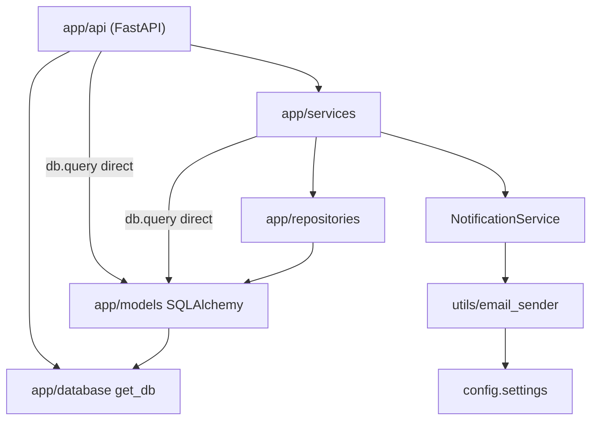

# Étape 1 — Diagnostic de l'architecture initiale

## Endpoints existants (Swagger `/docs`)

| Méthode | Route | Traité par |
|---|---|---|
| GET / POST | `/festivals` | `FestivalService` |
| POST | `/festivals/{id}/publish` | `PublicationService` (aucune vérification, notification après commit) |
| GET / POST | `/artists` | `ArtistService` |
| GET / POST | `/stages` | `StageService` |
| GET / POST | `/concerts` | `SchedulingService` |
| GET | `/concerts/{id}` | **requête SQL dans le contrôleur** |
| PATCH | `/concerts/{id}/reschedule` | contrôleur (SQL + R1) puis `SchedulingService.reschedule_concert` |
| POST | `/concerts/{id}/cancel` | `SchedulingService` |
| GET | `/concerts/schedule/{festival_id}` | `SchedulingService` (doublon de `GET /concerts`) |
| GET / POST | `/incidents` | **tout dans le contrôleur** (SQL + règle R10) |

Tests existants (`python -m pytest`) : 6 tests, tous verts, qui ne vérifient que la validation Pydantic et des cas d'erreur simples.

## Organisation et responsabilités

| Partie | Fichiers | Responsabilité réelle |
|---|---|---|
| Contrôleurs HTTP | `app/api/*.py` | Routage FastAPI, conversion des erreurs en codes HTTP… mais aussi requêtes SQLAlchemy directes (`concerts.get_concert`, `concerts.reschedule_concert`, tout `incidents.py`) et une règle métier (fin > début dans `reschedule_concert`) |
| Schémas | `app/schemas.py` | Validation Pydantic des requêtes / réponses (y compris `capacity > 0`) |
| Services | `app/services/*.py` | Règles métier (conflits, équipements, période du festival) mélangées à l'accès BD (`self.db.query(...)`, `commit`) et à l'envoi de notifications |
| Repositories | `app/repositories/*.py` | Accès BD partiel : CRUD simple qui fait lui-même le `commit` ; contourné par les services et contrôleurs |
| Modèles | `app/models.py` | Modèles ORM SQLAlchemy, utilisés partout comme objets « métier » (statuts en chaînes libres, équipements en texte séparé par des virgules) |
| Utilitaires | `app/utils/*.py` | `overlaps()` (règle de chevauchement isolée) et faux envoi d'e-mail piloté par la config |

## Dépendances

Toutes les flèches pointent vers la technique : le « cœur » (services) dépend de SQLAlchemy (`Session`, modèles ORM) et instancie lui‑même ses dépendances (`ConcertRepository(db)`, `NotificationService()`), ce qui empêche de les remplacer.

## Où sont les règles métier ?

| Règle | Emplacement initial | Problème |
|---|---|---|
| R1 fin > début | `SchedulingService.create_concert`, `reschedule_concert`, **et** `api/concerts.py`, `FestivalService` | dupliquée à 3 endroits |
| R2 / R3 chevauchements | `SchedulingService._check_conflicts` | **non appelée lors du déplacement** |
| R4 références existantes | `create_concert` | OK à la création seulement |
| R5 équipements | `create_concert` (parsing de chaînes) | non vérifiée au déplacement |
| R6 période du festival | `create_concert` | non vérifiée au déplacement |
| R7 planning publié | nulle part | `status` est un simple texte jamais consulté |
| R8 publication valide | nulle part (`PublicationService` : « contrôle incomplet ») | publication sans vérification |
| R9 capacité > 0 | uniquement Pydantic (`Field(gt=0)`) | contournable hors HTTP |
| R10 incident | contrôleur `incidents.py` (+ longueur Pydantic) | règle dans l'adaptateur HTTP |

## Dépendances directes à FastAPI / SQLAlchemy

- Les services reçoivent une `sqlalchemy.orm.Session` et manipulent les modèles ORM.
- `api/concerts.py` et `api/incidents.py` exécutent des requêtes SQL.
- La logique « échec de notification → 500 » est codée dans le contrôleur (`except RuntimeError → 500`).
- `FestivalService.publish` et `PublicationService.publish` font la même chose différemment (duplication).

## Exemple concret de responsabilité mal placée

`api/concerts.py::reschedule_concert` : le contrôleur HTTP interroge la base (`db.query(Concert)`), applique une règle métier (fin > début), puis appelle `SchedulingService.reschedule_concert`, qui **commit** le changement puis appelle `NotificationService` → `send_email`. Si l'e-mail échoue, la `RuntimeError` remonte jusqu'au contrôleur qui renvoie **500** alors que la base est déjà modifiée. Une seule méthode mélange ainsi HTTP, SQL, règles métier et effet de bord.

## Testabilité et risques d'incohérence

- Impossible de tester une règle sans base SQLite ni FastAPI (services liés à `Session`).
- `pytest` seul ne fonctionnait pas (`ModuleNotFoundError: app`) : il fallait `python -m pytest`. Ajout d'un `pytest.ini`.
- Les tests existants ne vérifient que la validation Pydantic, aucune règle métier.
- Commits dispersés (repositories, services) : pas de frontière transactionnelle claire.

## Reproduction des défauts

Les scénarios sont automatisés dans `tests/regression/test_defects.py` (marqués `xfail` avant correction).

**Défaut 1 — chevauchement**
1. `python -m app.seed`
2. `PATCH /concerts/2/reschedule` (Crimson Engine, Mainstage) avec `{"start_time":"2027-06-18T18:30:00","end_time":"2027-06-18T19:30:00"}`
3. Résultat : **200**, le concert chevauche Iron Vow (18:00–19:00) sur la même scène. Même chose si l'on déplace un concert d'Iron Vow d'une autre scène sur ce créneau (artiste à deux endroits).

**Défaut 2 — notification**
1. Définir `FESTIPLAN_FAIL_NOTIFICATIONS=true` puis lancer l'API
2. `PATCH /concerts/2/reschedule` avec un créneau libre
3. Résultat : **500** « service de notification indisponible »
4. `GET /concerts/2` : le nouveau créneau **est enregistré**.

**Défaut 3 — planning publié**
1. `POST /festivals/1/publish` → `status: "published"`
2. `PATCH /concerts/2/reschedule` avec un créneau libre
3. Résultat : **200**, le planning publié est modifié sans aucune procédure.
