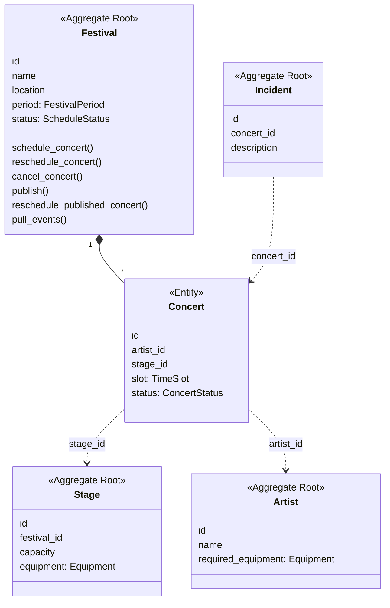
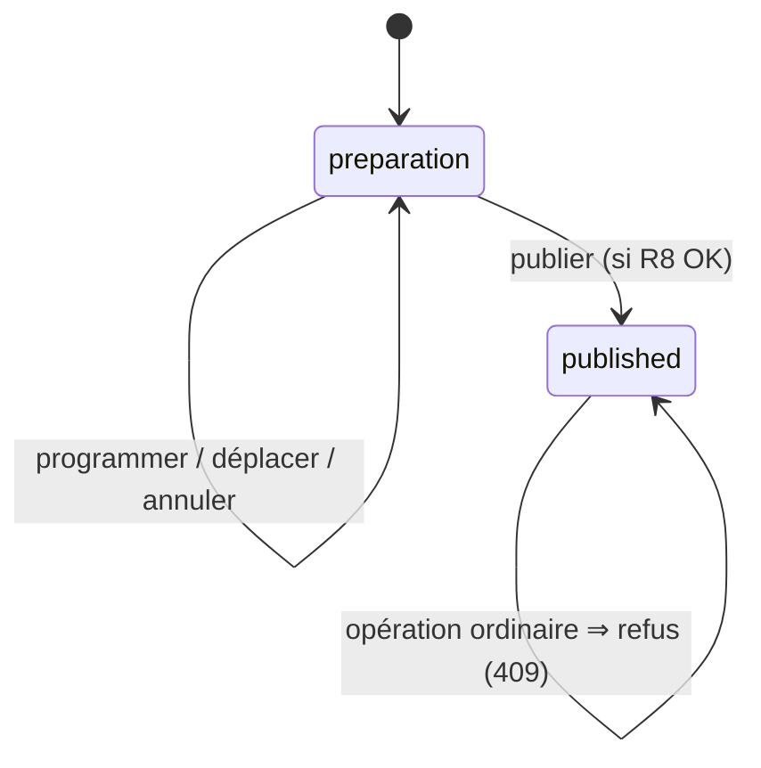

# Étape 2 — Modèle métier (DDD)

Niveau de DDD retenu : **DDD tactique léger** (métier « modéré », un seul bounded context *Programmation du festival*). Pas de cartographie de contextes : elle n'apporterait rien à ce projet.

Le code est dans `app/domain/` et ne dépend ni de FastAPI ni de SQLAlchemy.

## Entités

| Entité | Identité | Pourquoi une entité |
|---|---|---|
| `Festival` | `id` | cycle de vie : *preparation* → *published* ; deux festivals aux mêmes dates restent distincts |
| `Concert` | `id` | peut être déplacé ou annulé en restant « le même concert » |
| `Stage` | `id` | une scène est référencée par les concerts |
| `Artist` | `id` | un artiste est référencé par plusieurs concerts |
| `Incident` | `id` | fait déclaré, suivi (`resolved`) |

## Objets-valeurs (immuables, `@dataclass(frozen=True)`)

| Objet-valeur | Invariant vérifié à la création |
|---|---|
| `TimeSlot` (créneau) | R1 : fin strictement après début. Fournit `overlaps()` |
| `FestivalPeriod` | même invariant ; fournit `contains(slot)` pour R6 |
| `Equipment` | ensemble normalisé de noms d'équipements ; fournit `missing_from()` pour R5 |

Ils remplacent les données brutes (`start_time`/`end_time` séparés, chaîne `"a,b,c"`) et centralisent les règles correspondantes.

## Agrégats

- **Festival (planning)** = `Festival` + ses `Concert`. Les règles R2, R3, R7, R8 portent sur *l'ensemble* des concerts d'un festival : elles ne peuvent être garanties que si toutes les modifications passent par une même racine. Un `Concert` n'a pas de méthode publique de modification : on déplace/annule un concert via le `Festival`.
- **Stage**, **Artist**, **Incident** sont des agrégats séparés, référencés **par identifiant**. Ils évoluent indépendamment (un artiste peut être créé sans festival) ; les inclure dans le festival agrandirait l'agrégat sans protéger de règle supplémentaire. Pour vérifier R4/R5 le festival reçoit la scène et l'artiste concernés en paramètre (lecture seule).

## Invariants et emplacement

| Règle | Où elle est garantie |
|---|---|
| R1 fin > début | objet-valeur `TimeSlot` |
| R2 pas de chevauchement sur une scène | agrégat `Festival._check` |
| R3 artiste pas à deux endroits | agrégat `Festival._check` (dans le périmètre du festival) |
| R4 références existantes | cas d'utilisation (chargement via les ports → 404) + agrégat (scène du bon festival) |
| R5 équipements | `Equipment.missing_from` appelé par `Festival._check` |
| R6 dans la période du festival | `FestivalPeriod.contains` appelé par `Festival._check` |
| R7 planning publié verrouillé | `Festival._ensure_in_preparation` ; seule `reschedule_published_concert` (motif obligatoire) modifie un planning publié |
| R8 publication valide | `Festival.publish` revérifie tous les concerts actifs |
| R9 capacité > 0, durées > 0 | entité `Stage` ; durée > 0 garantie par `TimeSlot` |
| R10 incident | entité `Incident` (description non vide) + cas d'utilisation (concert existant) |

La validation Pydantic reste dans l'adaptateur HTTP (format des requêtes) mais n'est plus la seule protection.

## États du planning

Décision (défaut 3) : après publication, le déplacement ordinaire est **refusé** ; une **procédure explicite** `reschedule_published_concert` permet de modifier un concert publié, avec motif obligatoire et notification du public. Le planning reste publié.

## Événements de domaine

| Commande (intention) | Cas d'utilisation (orchestration) | Événement (fait accompli) | Réaction technique |
|---|---|---|---|
| `RescheduleConcertCommand` | `RescheduleConcert` | `ConcertRescheduled` | notification à la production |
| `ReschedulePublishedConcertCommand` | `ReschedulePublishedConcert` | `PublishedConcertRescheduled` | notification au public |
| `PublishScheduleCommand` | `PublishSchedule` | `SchedulePublished` | notification au public |

L'agrégat enregistre les événements ; ils ne sont transmis au notificateur **qu'après la sauvegarde** (on n'émet pas un fait non confirmé).
