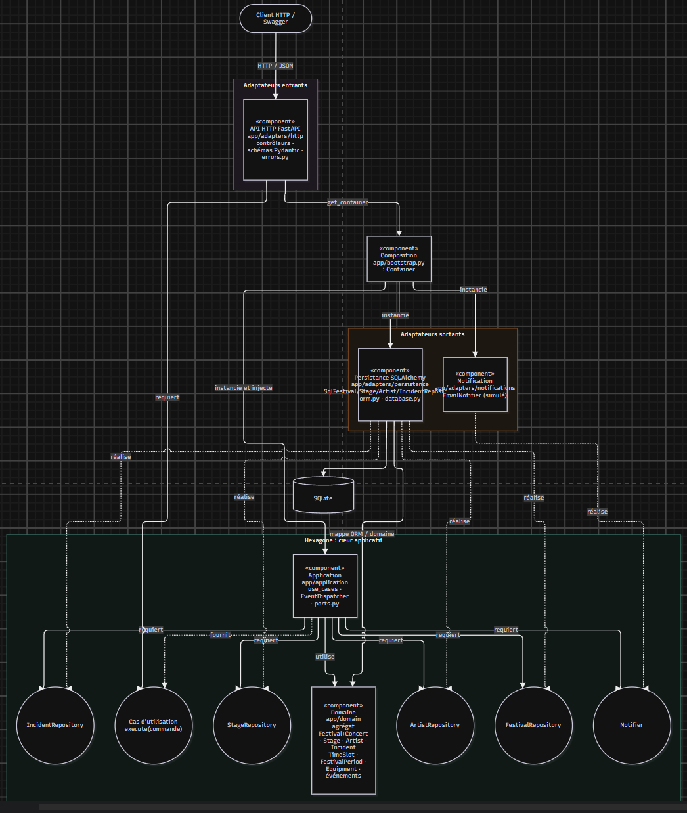

# Diagramme de composants (architecture réelle)

Les flèches représentent les dépendances de code (`import`). Toutes pointent vers le cœur : le domaine ne dépend de rien, l'application ne dépend que du domaine et de ses propres ports.

Légende (notation UML) : rectangle `«component»` = composant ; cercle = interface (port) ; flèche pleine « requiert » = interface requise ; flèche pointillée « réalise » = interface fournie / implémentée. Toutes les dépendances pointent vers l'hexagone : `app/domain` et `app/application` n'importent ni FastAPI ni SQLAlchemy.

| Port (contrat, côté cœur) | Adaptateur (implémentation, côté infrastructure) |
|---|---|
| `FestivalRepository` | `SqlFestivalRepository` (charge / sauve l'agrégat festival + concerts en une transaction) |
| `StageRepository` | `SqlStageRepository` |
| `ArtistRepository` | `SqlArtistRepository` |
| `IncidentRepository` | `SqlIncidentRepository` |
| `Notifier` | `EmailNotifier` (envoi simulé, panne simulable par `FESTIPLAN_FAIL_NOTIFICATIONS`) |
| *(tests)* tous les ports | `tests/fakes.py` : implémentations en mémoire + `FakeNotifier` |

**Chemin d'une requête** : HTTP → contrôleur (validation Pydantic, construction d'une *commande*) → cas d'utilisation (obtenu du `Container`) → ports → agrégat du domaine → sauvegarde via le port → `EventDispatcher` → `Notifier` → réponse construite par le contrôleur. Les exceptions métier remontent jusqu'à `errors.py`, seul endroit qui connaît les codes HTTP.
