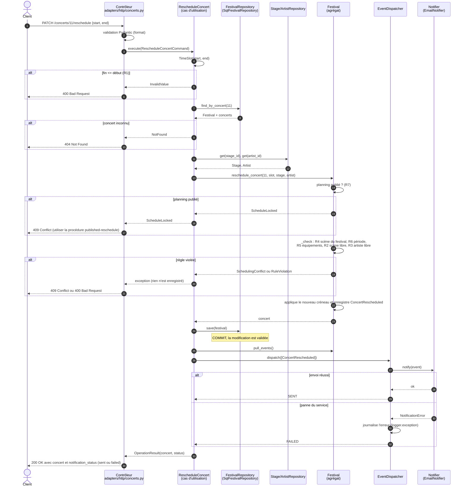

# Diagramme de séquence — déplacer un concert

`PATCH /concerts/{id}/reschedule`. La modification est **validée au commit** de `SqlFestivalRepository.save` ; la notification n'a lieu qu'**après**, et son échec ne change pas la réponse (200 + `notification_status: "failed"`).

